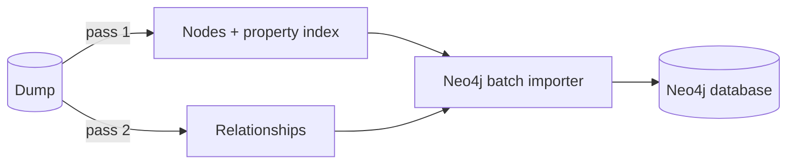

# wikidata-neo4j-batchimporter

CLI tool that reads a Wikidata JSON dump and writes a new Neo4j 5 database with the Neo4j batch importer (Java API, no Cypher, no running server). The graph model follows [findie/wikidata-neo4j-importer](https://github.com/findie/wikidata-neo4j-importer).

## Prerequisites

- Java 21+ (built with `--release 21`, tests run on JDK 25)
- A Wikidata JSON dump: a JSON array with one entity per line, optionally compressed (`.json`, `.gz`, `.bz2`). See the [dump format](https://doc.wikimedia.org/Wikibase/master/php/docs_topics_json.html).

## Build

```
./mvnw -q verify
```

Runs unit and integration tests and builds the executable `target/tools.jar`. Use `./mvnw -q package -DskipTests` to build without tests.

## Run

```
bin/wikidata-import.sh <json-file> <path> [options]
```

The script calls `java -jar tools.jar` and looks for `tools.jar` next to itself, then in `../target/`. Pass JVM options through `JAVA_OPTS`:

```
JAVA_OPTS="-Xmx8g" bin/wikidata-import.sh latest-all.json.bz2 /data/neo4j-home --progress
```

`<path>` is used as Neo4j home. It must not exist or must be empty. The database is created in `<path>/data/databases/neo4j` and opens with an embedded `DatabaseManagementServiceBuilder(<path>)` or as `NEO4J_HOME` of a Neo4j 5 server.

| Option | Default | Description |
|---|---|---|
| `--compression=auto\|none\|gzip\|bzip2` | `auto` | `auto` decides by file extension (`.gz`, `.bz2`). |
| `--error-log=<file>` | `<path>.errors.log` | Receives relationships that cannot be resolved. |
| `--chunk-size=<lines>` | `1000` | Dump lines read per chunk by each importer thread. |
| `--log-file=<file>` | none | Log with UTC timestamps: start and end of the import, the Neo4j import stages with estimates, durations and peak memory, Neo4j's internal messages and the stack trace of a failure. |
| `--progress` | off | Progress bar on stderr per import phase, with the running Neo4j stage, total elapsed time and an ETA for the current phase. Replaces the Neo4j progress output on stdout; with `--log-file` that output still goes to the log. |

Exit codes: `0` success, `1` import failed, `2` invalid arguments.

The progress bar follows the four phases of the Neo4j importer:

```
[#############-----------------]  43.2%  3/4 Relationship linking (Relationship <-- Relationship 1-38/9100)  elapsed 6h 12m  phase ETA 2h 05m
```

| Phase | Progress measured by |
|---|---|
| 1/4 Node import | bytes read in pass 1; `Prepare node index` follows at 100 % |
| 2/4 Relationship import | bytes read in pass 2 |
| 3/4 Relationship linking | relationships linked, as reported by Neo4j |
| 4/4 Post processing | relationship groups and records processed, as reported by Neo4j |

Linking runs in rounds when the relationship types do not fit into memory at once. The stage shows the type range of the round (`1-38/9100`). Every round scans the whole relationship store, so later rounds with few relationships take longer than their share of the percentage suggests.

## Release

Push a tag `vX.Y.Z` (or `vX.Y.Z-rc1` for a pre-release) to publish a GitHub release:

```
git tag v1.0.0
git push origin v1.0.0
```

The workflow runs the tests and attaches a ZIP with `tools.jar`, `wikidata-import.sh` and a SHA-256 file. See [docs/releasing.md](docs/releasing.md) for the full process.

## Graph model

| Source | Result |
|---|---|
| Item, property | `(:Entity:Item)` / `(:Entity:Property)` with `id`, `label`, `slug`, `descriptions`, `aliases` (English only); properties also have `datatype` |
| Statement with item or property value | `(Entity)-[:<PROPERTY_LABEL> {by, id}]->(Entity)`; `PROPERTY_LABEL` is the upper-cased English label of the property, `CLAIM` if unknown |
| Statement with any other value | `(Entity)-[:<PROPERTY_LABEL> {by}]->(:Claim:<Datatype>)`, e.g. `:Claim:Quantity`; the `id` property holds the statement id |
| Quantity unit, globe coordinate globe | `(:Quantity)-[:UNIT_TYPE]->(Entity)`, `(:GlobeCoordinate)-[:GLOBE_TYPE]->(Entity)`; `unit` / `globe` are removed from the node when they hold an entity URL |

Qualifiers, references, sitelinks, lexemes and statements whose snak type is not `value` are ignored. Rationale in [docs/adr](docs/adr).

## How it works

The Neo4j importer consumes all nodes before it asks for the first relationship. The tool therefore reads the dump twice instead of buffering relationships:



- Pass 1 emits entity and claim nodes and collects `property id -> relationship type`.
- Pass 2 emits relationships using the complete property index, so properties may appear anywhere in the dump.
- The importer pulls chunks of raw lines from multiple threads. Parsing and mapping run outside the read lock. Memory use is bounded by `threads x chunk size`.
- Node ids are passed to Neo4j as encoded integers instead of strings, which avoids string hashing and a temporary id store.
- A relationship whose target is missing in the dump goes to the error log. The import continues. Claim nodes appear there as `<entity>#<statement position>`, e.g. `Q100#3`.

## Limitations

- The ETA covers the current phase only. With several linking rounds it is too optimistic during phase 3.
- The import size estimates passed to Neo4j are derived from the file size and not tuned against a full dump.
